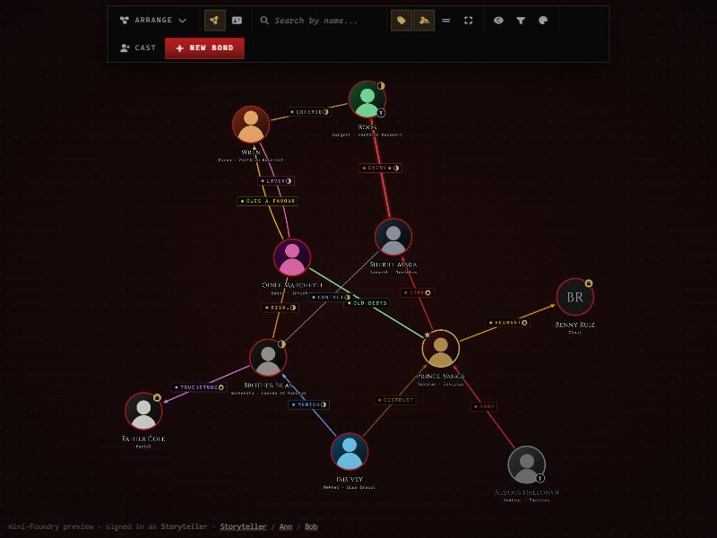
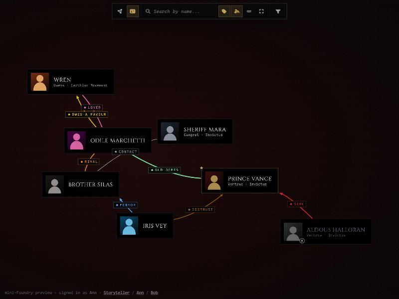

# Vampire Relationships

A relationship map for vampire chronicles in **Foundry VTT v14**, drawn on its own scene.

Characters are ordinary tokens, shown as portraits. The ties between them (sire and childe,
regnant and ghoul, allies, rivals, debts) are coloured, labelled lines. **Who sees what
follows Foundry ownership**: a player only meets the characters they have ownership of, and
every bond has its own audience.

Built for the [Vampire the Requiem 2E](https://github.com/Limpbark/vampire-the-requiem-2e)
system. It runs in any other system too; it just has less to print under each name.





*Screenshots are from the development preview, with stand-in portraits.*

## Install

In Foundry: **Add-on Modules → Install Module**, and paste this manifest URL:

```
https://github.com/Limpbark/vampire-relationships/releases/latest/download/module.json
```

Enable **Vampire Relationships** in your world. Foundry will offer updates whenever a new
release is published.

## Getting started

1. **Create a map.** The first time a Storyteller loads the world, the module offers to
   create one. Later, use the **Relationship Map** button at the top of the Scenes sidebar,
   or right-click any scene and choose **Use as Relationship Map**.
2. **Add the cast.** Drag Actors from the sidebar onto the map, or press **Cast** on the
   toolbar to tick a whole court at once.
3. **Bind them.** Select one or two tokens and press **New Bond** (or `Shift+B`). Pick the
   type, add a label if you like, and choose who sees it.
4. **Arrange.** **Arrange → Network** pulls everyone together by their bonds. Drag tokens to
   taste; they are normal tokens.

Selecting a character opens their **dossier**: every tie they have, grouped by kind, with
their sire and childer at the bottom.

## Who sees what

Everything hangs off Foundry's own ownership levels.

| Thing | Visible to a player when... |
| --- | --- |
| A **character** | they hold at least **Limited** ownership of its Actor (the level is a module setting). Set it the usual way, with *Configure Ownership*, or with the quick buttons in the dossier. |
| A **bond** | the bond's audience includes them (**Everyone**, **Storyteller only**, or **Specific players**) **and** they can see the characters at both ends. |
| **Clan and covenant** under a name | they have Observer ownership or better, or the sheet's *type known* box is ticked. |
| **Storyteller notes** on a bond | never. |

Storytellers see everything, with a gold lock on anything no player can see and a
half-filled mark on anything only some can. **See as a player** (the eye on the toolbar)
redraws the map through any one player's eyes, so you can check a secret before the session.

A token's ordinary *hidden* toggle still works and hides it from every player.

> Like all Foundry ownership, this controls what the interface shows. Foundry sends world
> data to every connected client, so a player determined to dig through the browser console
> can still find it.

## The map

- **Two looks.** *Constellation* shows round portraits with names beneath; *Cards* shows a
  portrait beside a name plate. Switch on the toolbar.
- **Bonds.** 27 types in four families (Blood, Loyalty, Feeling, Other), each with its own
  colour. A bond can carry an arrow, a label, a strength from 1 to 5 (line weight), a
  key-tie mark, public notes and Storyteller-only notes. Hover a label for details; click it
  to edit.
- **Arrange.** Network, Covenants, Clans, Lineage (sires above childer) and Circle, each
  with undo. With two or more tokens selected, only those are arranged.
- **Focus.** Hovering a character lights their ties and steps everything else back. Search
  by name; press Enter to jump there.
- **Filters.** Hide bond types you do not want to look at right now. Filters are personal.
- **Appearance.** Portrait source (Actor portrait or token image), outlines around each
  covenant or clan, patterned lines by family, and a layout lock.
- **Character marks.** Status (Torpor, Missing, Final Death) and a star for key people, set
  from the dossier. A character marked dead on their sheet is greyed out automatically.

Bonds are stored on the Actor they start from, not on the scene. Put the same characters on
a second map and their ties come with them.

## Settings

| Setting | Default | |
| --- | --- | --- |
| Ownership needed to see a character | Limited | Raise it to Observer or Owner for a stricter table. |
| New bonds are visible to | Everyone | Or start every bond as Storyteller-only. |
| Players may rearrange the map | Off | When off, only Storytellers can drag characters. |
| Open the dossier on select | On | Per user. |

## For macro and module authors

```js
const vr = game.modules.get("vampire-relationships").api;

await vr.createMapScene({ name: "The Court" });
await vr.bonds.save({ from: actorA.id, to: actorB.id, type: "sire", label: "Embraced 1892" });
vr.bonds.of(actorA.id);        // { out: [...], in: [...] }
vr.openDossier(actorA.id);
```

Bond types are listed in [`scripts/constants.mjs`](scripts/constants.mjs).

## Development

No build step. The code under `scripts/` is plain ES modules.

```
node dev/test.mjs      # logic tests and a translation-key check; no dependencies
node dev/serve.mjs     # then open http://localhost:5179/dev/ui.html
```

`dev/ui.html` runs the real module inside a small stand-in for Foundry with an invented
court, which is handy for working on the drawing and the interface. It borrows PIXI,
Handlebars and icons from a local Foundry install (set `FOUNDRY_APP` if yours is not in the
default Windows location). It is not a substitute for testing in a real world.

To publish a release, push a version tag:

```
git tag v0.2.0
git push origin v0.2.0
```

GitHub Actions stamps the version into `module.json`, builds `module.zip` and attaches both
to a new release.

## Credits

The look and flow are inspired by the relationship map in
[GhoulApp](https://ghoulapp.com), a companion app for Vampire: The Masquerade. This module is
an independent work, shares no code or assets with it, and is not affiliated with or endorsed
by its authors.

Vampire: The Requiem and Chronicles of Darkness are trademarks of Paradox Interactive AB.
This is unofficial fan-made software and is not affiliated with or endorsed by Paradox
Interactive.

## License

[MIT](LICENSE)
